# opencode-remote · 完整交互链路与时序图

日期：2026-10-14。状态：设计修订稿，尚未实现。本文属于设计文档，供开发与验收直接引用。

四份协议定义见 [契约目录](03-contracts-index.md)。本文件展示这些契约如何串成用户可见的流程；端点以固定opencode版本的官方前端实际调用为准，capri不翻译业务端点。

## 1. hub究竟是什么

hub是capri-hub服务，通常部署在一台有公网IP的服务器/VPS上。首版一个hub实例就能中继多台被控机器；浏览器和host都能主动访问它，因此被控机器无需公网IP或端口映射。不同主机的子域指向同一个hub，不增加服务器数量。

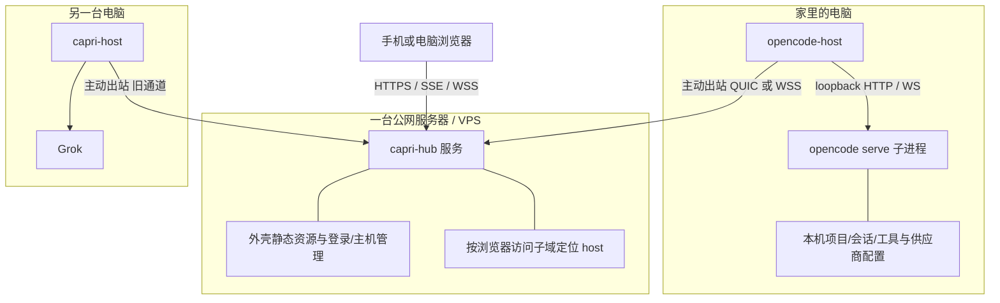

图中连接建立方向是host→hub，但建立后的隧道双向传数据；hub可以沿这个已存在的连接下发浏览器请求。shared-transport编译在host和相关组件里，是库，不需要再部署一台“传输服务器”。

浏览器UI逻辑在浏览器运行，外壳资源来自hub，opencode官方前端资源经hostOrigin中继取回。本机文件操作、工具执行和模型供应商调用由opencode发起；hub不执行这些命令。hub终止浏览器TLS并处理HTTP，因此能接触中继的请求/响应内容；不宣称它是业务内容不可见的端到端加密节点。

## 2. 首次配对、启动、登记

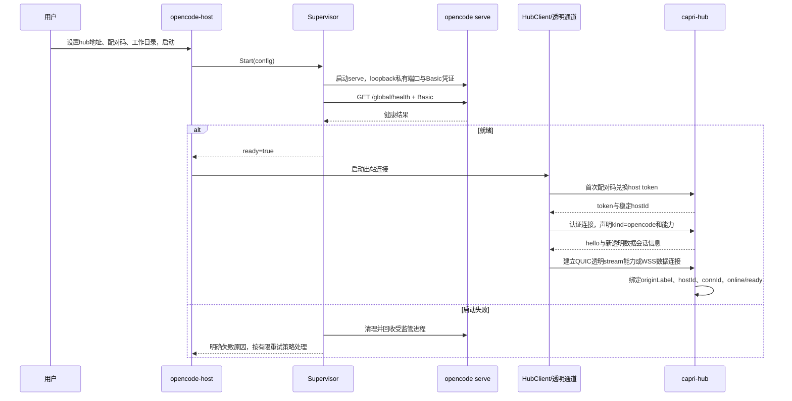

首次配对兑换沿用旧模型；以后host用本地保存token认证，不反复消耗配对码。hostId与显示名分开；显示名可改，origin保持稳定。新透明连接成功后才能接收新通道请求，opencode健康未通过时不能把主机标成可服务。

opencode-host和opencode serve是两个进程。用户只有一个host启动入口。托盘封装将是后续功能，不应写成这两个进程已经合并。

## 3. 浏览器登录外壳

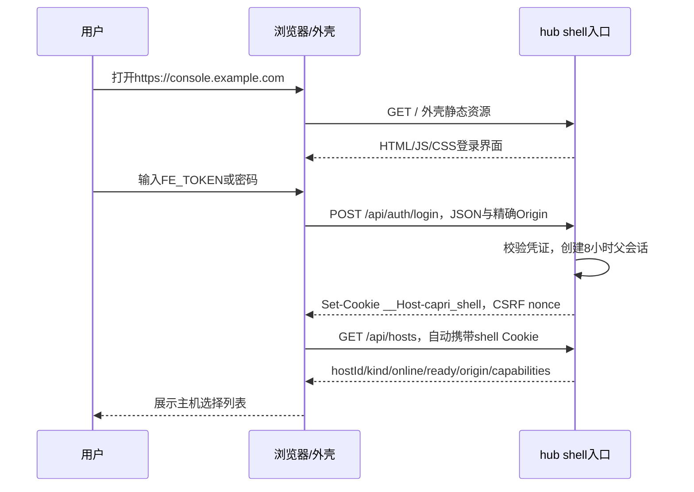

FE_TOKEN仅用来建立登录会话。浏览器后续业务连接使用Cookie，不要求修改官方前端去添加capri请求头。外壳的管理写操作带CSRF nonce；opencode iframe的业务写请求由精确Origin/Referer策略保护。

## 4. 选择opencode主机并加载iframe

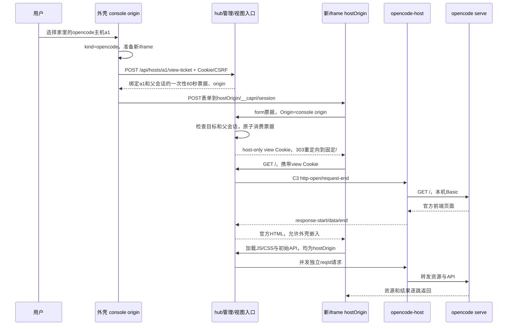

票据由hub消费，不交给opencode。iframe中的JS运行origin是主机子域；它的相对API路径也落在这个子域，因此没有shell→opencode的跨源API请求。父外壳只负责切换和登录，不读官方前端内部状态。

官方前端的资源可得性、相对路径与iframe能力尚待固定版本验证。如果此路径不兼容，先修订承载契约，再进入编码，不能默默换成自研UI。

## 5. 一条普通API：读取健康状态

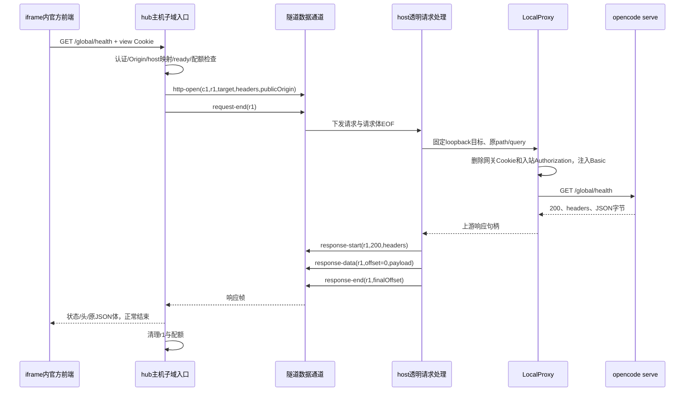

普通HTTP也用分块帧，不把完整响应加载到内存。状态码和多值头先回，再传body。路径/raw query保持原值，hub仅在控制面解析自己的路径，不识别opencode业务端点。

## 6. SSE长连接与一次prompt

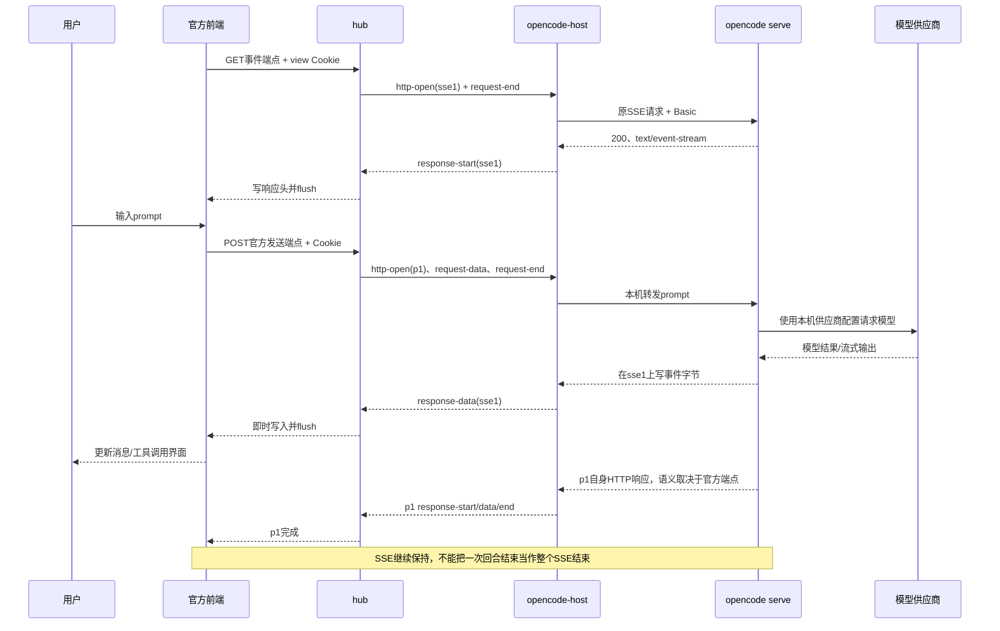

发送端点可能使用同步或异步机制；本设计不把所有prompt POST强行定义成立即ack。官方前端使用何种端点、响应何时完成，须按固定版本确认。模型连接由被控机器的opencode发起，不通过capri浏览器隧道。

SSE正文只是任意分块字节，隧道不理解message/permission等事件。没有事件时连接可以安静存在；本机已有心跳注释原样经过，capri不会向业务流注入心跳或错误事件。

## 7. 权限审批

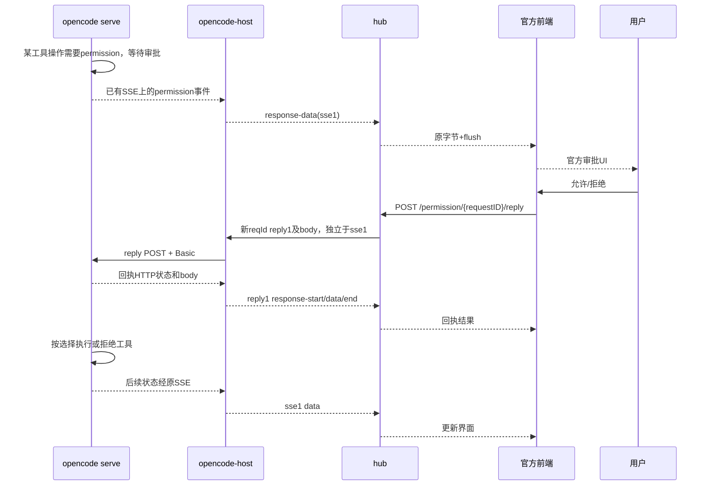

审批POST是新请求，必须能与一直打开的SSE并发。审批端点为M0记录的示例，实际请求以官方前端为准。慢SSE应只对自己的lane施加背压；不能因全局队列阻塞让审批回执永久等待。

## 8. PTY终端WebSocket

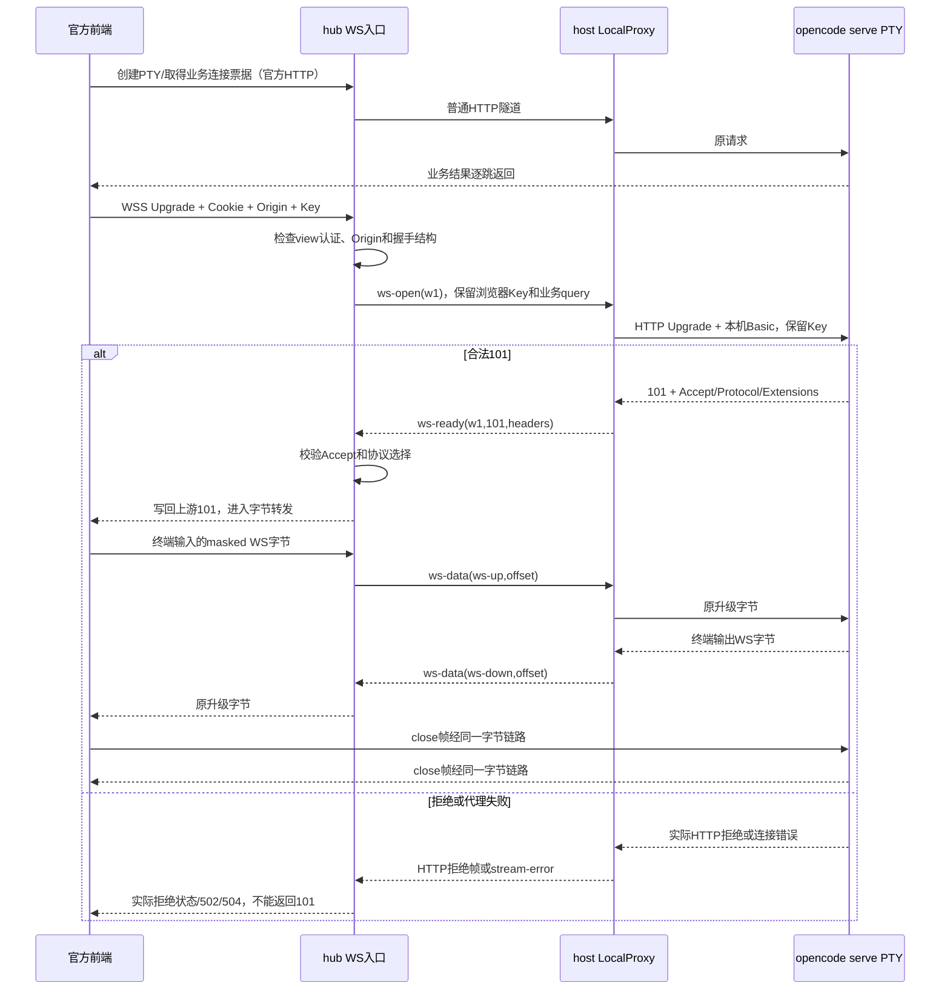

PTY连接票据与capri会话认证各管一层。WS close/ping/pong、frame fragmentation和mask都保留在字节中，不需要把每个内层WS frame变成一个中继JSON。host到hub的outer WSS是另一个传输层，其心跳不进入PTY内容。

## 9. 浏览器离开与取消

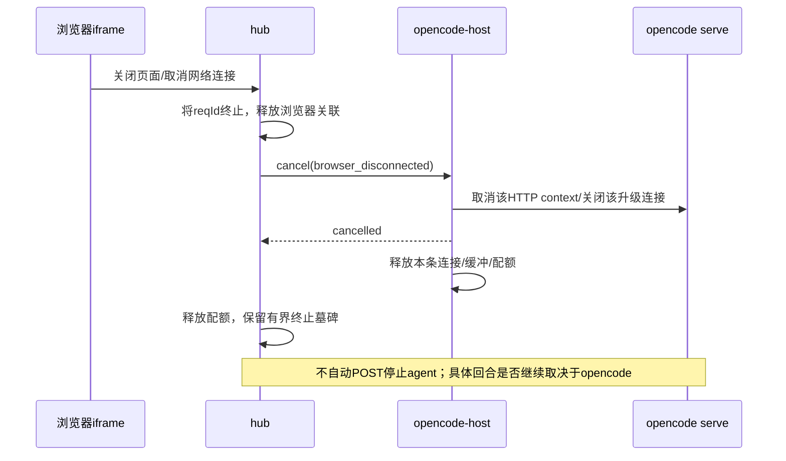

认证到期或logout触发相同的网络取消链路。主机进程不会因为关闭手机页面退出；网络取消的业务后果需要按官方端点核对。

## 10. host断线后重新上架

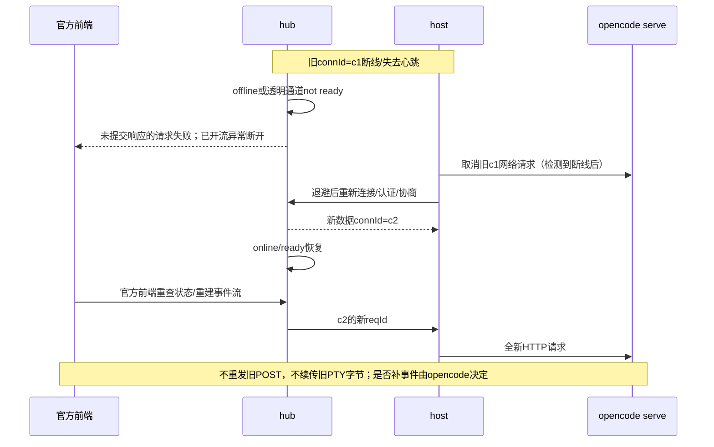

恢复网络与恢复会话数据是两件事。opencode本机持久会话可供重新查询，但中继不保证断线期间的所有SSE增量都能重现。

## 11. 主机切换

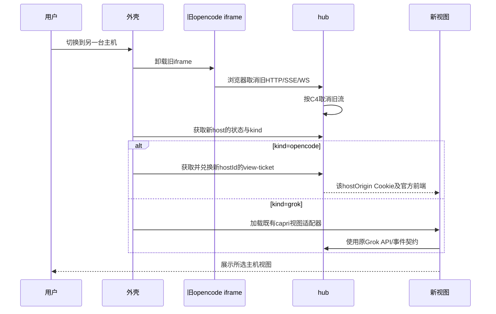

切换保存的是用户选择和各host自己已有会话。它不把两种agent会话格式互转；不会把新opencode tunnel流控施加到Grok事件面。Grok视图入口和选择配置需查capri-fe源码确认。

## 12. 本机/局域网直连（独立交付项）

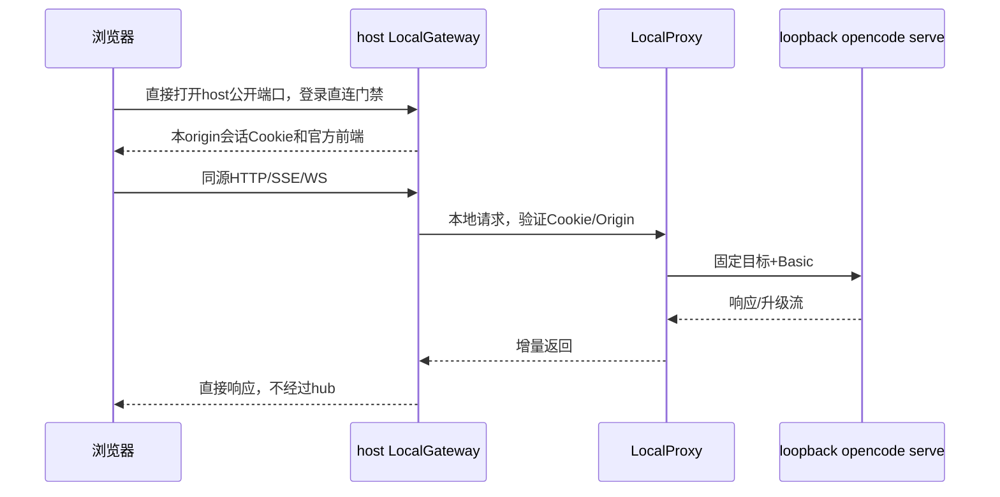

LocalGateway和opencode私有端口分别监听。局域网非loopback绑定需要直连认证和HTTPS；公网外壳自动选择LAN路径另需处理浏览器限制，不属于首条远程链路。

## 13. 未来实施顺序与通过条件

| 阶段 | 工作 | 通过后才进入下一阶段 |
|---|---|---|
| D0 设计与版本检查 | 补齐C1–C4、固定前后端版本，核对iframe/Origin/官方资源/其他仓库 | 关键前提有证据，失败则修订设计 |
| M1 共享库抽取 | 明确module/import布局，去掉Grok具体类型依赖；保留旧协议 | capri-host仍可编译、既有Grok行为通过回归 |
| M2a 普通API | 单host隧道能力协商、C3 HTTP帧，先GET /global/health | 状态/重复头/query/二进制/限额/取消正确；Basic仅本机 |
| M2b SSE | 相同HTTP帧增量响应与flush | 即时事件、长连接不累计缓存；取消/慢网/认证到期处理正确 |
| M2c WS | Upgrade握手透传与双向字节流 | PTY输入输出、拒绝、close、较大frame、断线正确 |
| M3a 审批 | 官方前端发prompt与permission reply | 手机收到审批并生效；SSE与POST不会互相堵塞 |
| M3b 主机切换 | 外壳票据/iframe与kind适配器，多host | opencode↔opencode及opencode↔grok切换，Cookie/请求不串机 |
| M4 直连/打包 | LocalGateway、Windows托盘、部署说明 | 直连认证、hub离线可用、进程生命周期符合契约 |

本轮仅完成设计修订。表中所有验证都是未来实施验收，没有声称当前已通过。
