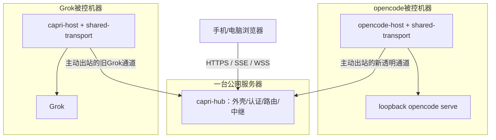

# capri 多 agent 平台 · opencode 远程接入 - 总体架构设计

> 2026-10-14 设计修订稿。当前仅设计，未实现、未完成端到端验收。
> 来源需求：[requirements.md](../../../requirement-agent/features/opencode-remote/requirements.md)（原文路径见文末）。
> 原M0记录的opencode版本为1.18.25；HTTP/SSE/PTY WS/Basic等记录是本机能力探测，不代表手机/公网/iframe链路已通过。

## 1. 目标与既定方向

把opencode接入capri：用户从统一浏览器入口选择被控机器，使用其官方opencode前端，继续会话、看流式进度、审批权限；现有Grok能力保留。被控机器通过主动出站接入hub，处于NAT后也不需要端口映射。

既定方向：中立多agent平台、双host二进制、共享传输库、自建透明HTTP平面、按host kind分叉、复用官方前端。首版单用户自托管；原生移动App、多用户云托管、端点翻译不在范围。

新增透明通道只负责HTTP和升级字节传输。Grok仍用原request/respond与events/seq/replay契约。agent特有的Basic注入与本机目标由opencode-host适配器负责。

## 2. hub与部署拓扑

hub是capri-hub服务，首版部署在一台公网服务器/VPS上。它提供外壳静态资源、登录与主机登记、主机子域入口和转发服务。多台host的子域可指向同一个hub公网IP和443端口。agent、项目文件、会话和模型供应商配置位于被控机器。

图中箭头标出连接建立方向；建立后的隧道双向传输。shared-transport是库，无需独立网络节点。hub处理浏览器TLS/HTTP，能够接触代理内容，不提供业务内容对hub不可见的端到端加密保证。

## 3. 当前系统与改动

现有capri-host由Grok ACP桥、本机API和hub客户端组成；Grok具体类型泄漏在bridge/manager等装配边界。现有relay响应记录器Flush为no-op，respond是一次终帧，不能直接承载SSE。现有QUIC请求独立流是可用基础，但新增能力仍需hub与host两侧协商和协议实现。

| 模块 | 改动 |
|---|---|
| shared-transport | 从host抽出公共连接/配对/状态工具；新增C3隧道、C4流控；导出的接口不含Grok/opencode类型 |
| capri-host | 使用共享库和本地Grok适配器；旧协议行为与seq分配位置保持原契约 |
| opencode-host | 新二进制，管理serve、LocalProxy、可选LocalGateway |
| capri-hub | 新增origin路由、浏览器会话/票据、透明数据连接和HTTP/升级入口 |
| capri-shell | 新浏览器TS外壳，列表/登录/切换；opencode iframe与Grok现有视图适配器 |
| 官方opencode前端 | 固定版本并复用；资源路径、iframe和Origin行为需验证 |

本目录已有capri-host；capri-hub和capri-fe修改还需要对应源码。不能仅修改host就宣称远程链路完成。

## 4. 四份契约与时序图

| 文档 | 具体决定 |
|---|---|
| [C1 Origin与路由](03-contracts/origin-routing.md) | console与每host HTTPS子域都指向hub；opencode视图iframe内API同源；固定loopback目标 |
| [C2 浏览器认证](03-contracts/browser-auth.md) | FE_TOKEN换父会话；一次性POST票据换host-only视图Cookie；认证覆盖HTTP/SSE/WS |
| [C3 HTTP隧道](03-contracts/http-tunnel.md) | 新能力协商；请求头/体、响应头/体、结束/取消/窗口；WS握手透传后原始字节流 |
| [C4 流生命周期](03-contracts/stream-lifecycle.md) | 有界缓冲、独立方向窗口、无payload丢帧、取消传播、断线不重放、Supervisor清理 |
| [完整交互链路](04-interactions.md) | 配对、登录、iframe加载、API、prompt/SSE、审批、终端、取消、重连、切换与直连 |
| [契约索引与前置检查](03-contracts/README.md) | 权威关系、设计状态与尚未验证的兼容性 |

以上具体技术选择是本轮设计方案，用户已要求补齐契约；不标记为已逐项确认或已实测。规范链接在对应契约内。

## 5. 关键数据与边界

### 5.1 HostDescriptor

| 字段 | 说明 |
|---|---|
| hostId / hostName / kind | 稳定身份 / 显示名 / grok或opencode |
| online / ready / lastSeenAt | 出站连接状态 / 本机服务就绪 / 最近心跳 |
| originLabel / origin | hub分配的opencode主机公开origin，不能由host指定任意域名；Grok按旧视图入口适配 |
| connId / capabilities | 当前透明数据会话与协议能力；重连后connId变化 |

### 5.2 TransparentRequest与响应

请求包含connId、reqId、method、target(path+raw query)、多值headers、可信publicOrigin，以及分块可读请求体。body不再是一个必须一次读满的base64字符串。

所有HTTP响应以response-start(status,headers)开始，经零个或多个response-data，最后response-end(trailers)。首版数据帧payload仍用base64，减少和旧JSON传输整合的复杂度；代价与上限见C3/C4。所有HTTP响应增量处理，不靠Accept:text/event-stream决定能不能流式。

WS独立升级分支将浏览器key转发给opencode，并将合法101返回浏览器；升级后双向传递原始WS字节。64 KiB是隧道块大小，不是内层WS frame大小。旧reqFrame.final不替代上述新协议。

### 5.3 公网API与凭证

shell新增登录/session/logout、已认证host列表、view-ticket API。hostOrigin新增保留网关端点/__capri/session。具体请求和Cookie作用域见C2。opencode业务路径仍原样透传，shell不把它们重命名为统一capri API。

浏览器会话Cookie、host配对token、opencode本机Basic三种身份分别校验。Basic由LocalProxy注入，传输库不读取opencode环境变量。iframe使用hostOrigin；不把shellOrigin的CORS作为该拓扑的依赖。

## 6. 模块与公共库布局

| 设计 | 责任 |
|---|---|
| [shared-transport](02-modules/shared-transport.md) | 中立连接协议、请求复用、帧、窗口与资源清理 |
| [opencode-host](02-modules/opencode-host.md) | Supervisor、LocalProxy、认证注入、官方视图、本机直连 |
| [capri-shell](02-modules/capri-shell.md) | HostRegistry、浏览器认证、异步ViewRouter、视图卸载 |
| [capri-hub](02-modules/capri-hub.md) | 域名与host绑定、认证/票据、Browser请求到隧道的桥接 |

共享库若独立Go module，公共包放module根下公开目录transport/hubstate/netinfo/procattr，供其他repo导入；不能把独立共享API仍放在capri-host/internal下并期待外部module直接import。opencode-host首版仍计划放capri-host repo的cmd/opencode-host和internal/ochost，以实现双二进制；Grok适配器留在该repo。实际module名称、发布位置和本地workspace连接在编码前确定，不擅自使用用户尚未拥有的远程repo名。

## 7. 业务链路

详细时序图直接纳入设计：[04-interactions.md](04-interactions.md)。图中逐跳表示hub、隧道、host和opencode，不再用Browser直达host的简图表达公网流程。

关键顺序：host就绪/登记 → 外壳登录/选机 → 票据换视图Cookie → 官方iframe同源HTTP → SSE长流 → 并行prompt/审批POST → 可选PTY WS。切换卸载旧视图触发网络取消；是否继续agent回合由opencode决定。

## 8. 实施顺序与验收

| 阶段 | 未来工作/通过条件 |
|---|---|
| D0 | 固定版本并核对官方资源、iframe、Origin、hub/fe源码；这是尚未完成的前提检查 |
| M1 | 共享库抽取与中立适配；完成既有Grok回归后进入新能力 |
| M2a | 单host普通GET健康请求打通；状态、多值header、raw-query、二进制、取消和限额正确 |
| M2b | SSE即时flush、长期不累计缓存、慢网背压和认证到期清理 |
| M2c | WS Upgrade/拒绝/双向PTY/大frame/关闭/断线正确 |
| M3a | 官方前端远程审批有效，长SSE不阻塞POST |
| M3b | 多host与kind切换、登录与请求隔离，Grok/opencode两种视图正确 |
| M4 | 本机LocalGateway、托盘/部署；hub不可用时直连仍可用 |

最终用户验收：手机4G使用家里opencode继续历史会话；使用同一官方前端；可远程审批；跨host/kind切换；未授权请求被拒；Grok零回归。这些均是目标，没有报告当前已通过。

近路不走hub；远程经hub中继。延迟与并发目标待实际部署测量，不以“≤1 RTT”作为已证明保证。首版性能起始预算见C4。

## 9. 风险与必须保留的未验证项

- 路径前缀并未被M0证明支持；本方案选独立origin。先前“已证明路径前缀不可行”的措辞过强，修正为“缺乏支持证据，不作为方案依赖”。
- 官方前端资源取得、固定版本与iframe能力尚未验证；失败需修订承载方案。
- opencode对实际hostOrigin/Host/WS Origin/认证的行为待核对，不能用盲目伪造localhost来源兜底。
- 透明代理降低端点变化带来的适配工作，但无法免疫前端构建、认证或协议变化；保留版本兼容检查。
- 流量高时不能丢字节；背压用独立窗口、有界缓存和取消。
- 已提交HTTP响应后只能中断，不能回写一个新的504；隧道断线不重放请求，不承诺opencode SSE增量全补。
- “单进程”修正为“单启动入口、一个用户公开HTTP端口”；serve是受监管子进程，另有私有loopback端口。本机直连由可选LocalGateway承担，不能由未监听HTTP的HubClient自动提供。

## 10. 依据与状态

需求文件：`docs/agents/requirement-agent/features/opencode-remote/requirements.md`；M0原始记录：[分析文档](../../../../../分析/opencode远程控制-需求分析文档.md)。既有代码行号是原快照分析线索，随源码变化不能当作永久位置。

本轮只编辑Markdown设计文档，未编写/修改实现、启动服务或执行软件测试。设计状态与新技术选择记录在[state.md](state.md)及[decisions.md](decisions.md)。
