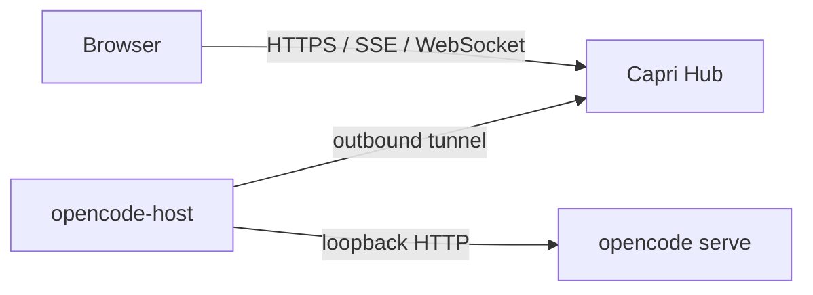

# Capri OpenCode architecture

## Goal

Use OpenCode's own web application from a browser, including when the OpenCode
server runs on a machine behind NAT. Capri Hub runs on a public server;
`opencode-host` makes an outbound connection from the OpenCode machine and
relays browser traffic to its loopback server.

## Components

| Component | Responsibility |
|---|---|
| `capri-hub` | Browser sign-in, host pairing and selection, view tickets, host routing, and public HTTPS reverse-proxy integration. |
| `opencode-host` | Starts `opencode serve` on loopback, injects local credentials when configured, and forwards HTTP/SSE/WebSocket traffic. |
| `capri-transport` | Shared tunnel frames, flow control, and WebSocket framing used by the host and Hub. |
| OpenCode web app | The browser interface and API, served by the local OpenCode server. |

## Request path

1. The host connects outward to the Hub and authenticates with its paired host
   token.
2. The browser signs in to the Hub and selects an online host.
3. The Hub issues a short-lived view ticket and routes the browser to that
   host's origin.
4. The OpenCode frontend sends its own API, SSE, and WebSocket requests through
   the Hub tunnel to `opencode serve` on loopback.

The Hub and host are separate deployments. The Hub belongs on a public server
behind an HTTPS reverse proxy; `opencode-host` belongs on the machine running
OpenCode. See [deployment](06-deployment.md) for configuration.

## Security boundaries

- Keep the OpenCode server bound to loopback; do not expose its port publicly.
- Keep the host pairing token and OpenCode credentials out of Git and logs.
- The Hub validates browser sessions and view tickets before routing requests.
- The host tunnel targets its configured local OpenCode server, not a
  browser-supplied arbitrary address.

## Scope

OpenCode is the only supported agent integration in this source tree.
